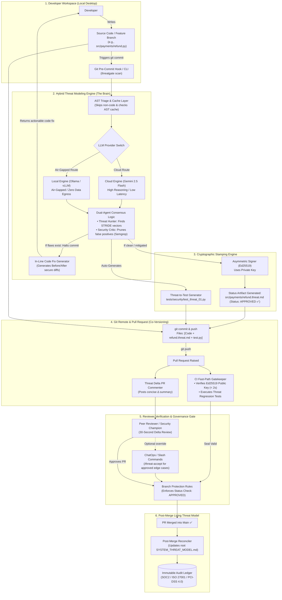
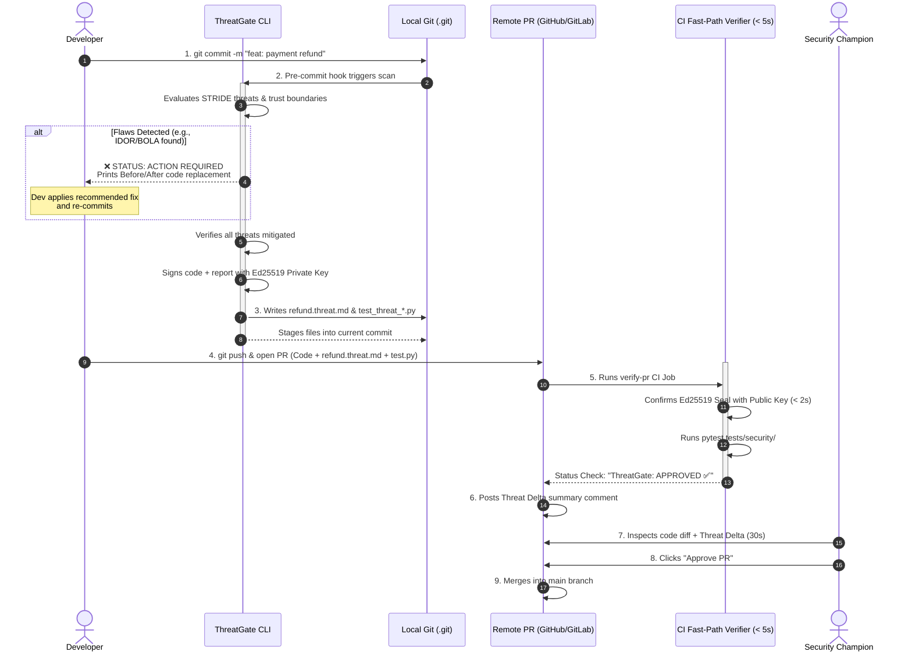
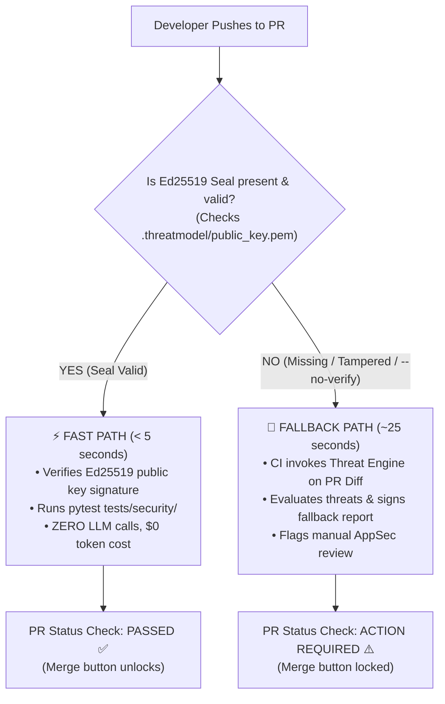

# 🛡️ ThreatGate: System Architecture Specification
**Document Version:** `1.0.0-RELEASE`  
**Classification:** `Core System Architecture & Component Design`  
**Status:** `Approved for Implementation`  
**Target Lifecycle:** `Developer ➔ Code ➔ Threat Model Tool ➔ Status Artifact ➔ Git ➔ PR (Code + Status) ➔ PR Approved`

---

## 1. Executive Summary & Core Paradigm

**ThreatGate** is an automated, code-first threat modeling and continuous governance engine. It solves the historic disconnect in Application Security (AppSec) between high-level architectural threat modeling (STRIDE) and low-level source code pull requests.

### Core Value Propositions
* **Shift-Left Upfront:** Architectural STRIDE analysis is performed on the developer's workstation *before* or *at the point of* git commit.
* **Actionable Remediation:** The tool does not simply flag threats; it outputs syntactically valid, drop-in replacement code fixes.
* **Component-Scoped Scoping:** Threat models are co-located with source code (`<name>.threat.md`), eliminating Git merge conflicts across concurrent feature branches.
* **Cryptographic Non-Repudiation:** Status artifacts are sealed using asymmetric **Ed25519** digital signatures, preventing local tampering or forgery.
* **Two-Speed CI/CD Pipeline:** CI/CD pipelines validate signatures in $< 5\text{ seconds}$ using public keys, reserving LLM compute strictly for developer workflows or unverified fallbacks.

---

## 2. Master System Architecture Diagram

---

## 3. End-to-End Sequence Map

---

## 4. Layer-by-Layer Architectural Specifications

### Layer 1: Developer Workspace (Client Tier)
* **Trigger Mechanism:** Runs automatically via `.git/hooks/pre-commit` or on-demand via `threatgate scan -p <file>`.
* **Zero Disruption:** Executes on staged files in the developer's local shell. If code is clean, it auto-stages the generated `.threat.md` without requiring manual secondary commits.

### Layer 2: Hybrid Reasoning Engine (Inference Tier)
* **AST Pre-Filter:** Parses file syntax trees using Tree-sitter or Python `ast` to strip comments and whitespaces. If the AST hash matches an existing cached verdict, it returns an approval in $< 20\text{ ms}$.
* **Dual-Agent Architecture:**
  * **Threat Hunter Agent:** Dissects entry points, privilege transitions, and persistence sinks to formulate STRIDE threats.
  * **Security Critic Agent:** Uses deterministic Semgrep taint-flow analysis to prune false positives caused by upstream framework middleware.
* **Provider Routing:** Abstracted client supporting both commercial cloud APIs (`gemini-2.5-flash`) and local air-gapped endpoints (`ollama/qwen2.5-coder`).

### Layer 3: Cryptographic Stamping Engine
* **Algorithm:** Pure Ed25519 (RFC 8032) asymmetric digital signatures.
* **Key Architecture:**
  * **Private Key:** Stored strictly in developer `.env` or internal KMS. Never committed.
  * **Public Key:** Committed to the repository at `.threatmodel/public_key.pem`.
* **Mathematical Binding:**
  $$\text{CodeDigest} = \text{SHA256}(\text{CodeContent}_{\text{normalized}})$$
  $$\text{DigitalSeal} = \text{Sign}_{\text{Ed25519PrivKey}}(\text{CodeDigest} \parallel \text{ReportContent}_{\text{normalized}})$$

### Layer 4: Git Co-Versioning Tier
* **Component-Scoped Paths:** Threat models are named `<filename>.threat.md` and live in the same directory as the source code.
  * *Benefit:* Eliminates Git merge conflicts between parallel feature branches.
* **Threat-to-Test Durability:** The tool auto-generates a companion regression unit test in `tests/security/test_threat_<id>.py`. If a future developer removes the security check, standard unit testing immediately fails.

### Layer 5: Reviewer Verification & Governance Gate
* **Threat Delta ($\Delta$):** The PR bot calculates what changed between `main` and the branch, posting a high-contrast 4-line summary showing neutralized threats, new trust boundaries, and open risks.
* **Reviewer Efficiency:** Peer reviewers and Security Champions can verify security intent in under 30 seconds.
* **Break-Glass Overrides:** Reviewers can accept edge-case risks via PR slash commands:
  `/threat-accept TH-01 reason="Protected by upstream Cloudflare WAF"`

### Layer 6: Post-Merge Living Threat Model & Audit Ledger
* **Continuous Synchronization:** A GitHub Action running on `push: [main]` parses merged `.threat.md` files and updates the root `SYSTEM_THREAT_MODEL.md`.
* **Audit Trail:** Appends an entry to `.threatmodel/audit_ledger.jsonl`, providing permanent evidence for compliance audits.

---

## 5. Two-Speed CI/CD Pipeline Architecture

---

## 6. Comparison with Existing Industry Tools

| Dimension | Traditional Tools (IriusRisk, MS TMT) | SAST Scanners (Snyk, Semgrep, CodeQL) | **ThreatGate Architecture** |
| :--- | :--- | :--- | :--- |
| **Input** | Manual architecture diagrams & forms | Source code syntax & regex | **Source code & Git diffs** |
| **Scope** | High-level system design (disconnected from code) | Low-level syntax bugs / CVEs | **Architectural STRIDE flaws & trust boundaries** |
| **Timing** | Design phase (months before release) | CI/CD build or IDE typing | **Upfront at commit + Verified on PR** |
| **Remediation** | Text recommendations only | Basic quick-fixes for syntax bugs | **Full Before/After secure code replacements** |
| **Git Coupling** | Disconnected (stored in external DBs) | PR inline comments | **Co-committed `<name>.threat.md` in Git** |
| **Merge Safety** | N/A (Central tool) | N/A (Stateless) | **Component-scoped (Zero merge conflicts)** |
| **Integrity** | Unenforced | Fails build | **Cryptographic Ed25519 Digital Seal** |
| **Reviewer Gate** | Manual Jira tickets | Static alerts | **PR-native review of Code + Status together** |

---

## 7. Compliance Crosswalk (SOC2, PCI-DSS 4.0, ISO 27001)

| Standard | Control Reference | Requirement | How ThreatGate Satisfies It |
| :--- | :--- | :--- | :--- |
| **PCI-DSS v4.0** | **Req 6.2.3** | Threat modeling required for significant architectural changes. | Every PR touching business logic co-commits a verified `.threat.md`. |
| **PCI-DSS v4.0** | **Req 6.3.2** | Software vulnerabilities must be verified prior to release. | CI fails build if Ed25519 signature is missing, invalid, or tampered. |
| **SOC 2 Type II** | **CC7.1 / CC7.2** | System changes are authorized, designed, and tested prior to production. | PR history proves peer sign-off of code + threat models side-by-side. |
| **ISO/IEC 27001** | **Control A.8.25** | Secure system development lifecycle rules must be enforced. | Pre-commit hook enforces automated STRIDE evaluations by default. |

