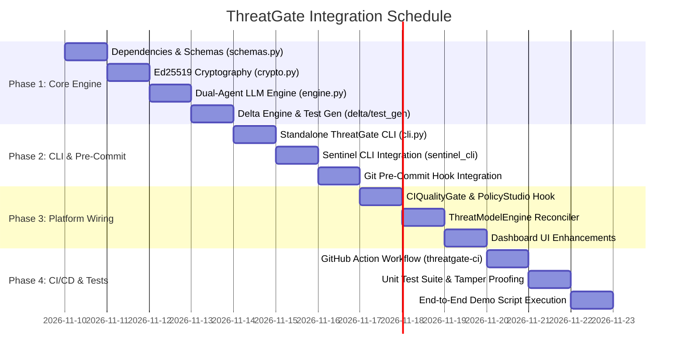

# 🚀 ThreatGate Integration Plan: Code-First Threat Modeling in Sentinel AppSec

**Document Version:** `1.0.0`  
**Target Platform:** Sentinel AppSec Platform (`sentinal-scanner-main`)  
**Associated Documents:** [`THREATGATE_ARCHITECTURE.md`](file:///c:/Users/aravind.anil/Downloads/sentinal-scanner-main/THREATGATE_ARCHITECTURE.md), [`THREATGATE_BLUEPRINT.md`](file:///c:/Users/aravind.anil/Downloads/sentinal-scanner-main/THREATGATE_BLUEPRINT.md)  
**Status:** `Approved Plan for Execution`  

---

## 1. Executive Summary & Purpose

The purpose of this integration is to embed **ThreatGate**—a next-generation, code-first threat modeling and cryptographic PR gating engine—directly into the **Sentinel AppSec** platform.

### The Problem It Solves
Sentinel AppSec currently features a multi-engine AST scanner (SAST, SCA with reachability, Secrets, IaC, DAST, RASP), an automated STRIDE threat modeler, and CI quality gates. However:
1. Threat modeling is currently evaluated **reactively** after code is committed or pushed.
2. Threat models are not mathematically bound to the source code, allowing silent drift.
3. CI pipelines that call LLMs on every PR suffer high latency (30–90s) and API costs.
4. Developers refactoring code can accidentally delete security checks without failing unit tests.

### What ThreatGate Adds to Sentinel
* **Shift-Left Upfront**: Threat modeling occurs on developer workstations during `git commit` via pre-commit hooks.
* **Component-Scoped Scoping**: Models are co-located alongside source files (`<name>.threat.md`), eliminating Git merge conflicts.
* **Cryptographic Tamper-Proof Sealing**: Status artifacts are signed using pure **Ed25519** digital signatures, binding the SHA-256 code digest to the report.
* **Two-Speed CI Gatekeeper**: Verifies Ed25519 signatures with `.threatmodel/public_key.pem` in **$< 5\text{ seconds}$** with **$0 token cost** (zero LLM calls in normal CI).
* **Threat-to-Test Automation**: Auto-generates companion `pytest` regression unit tests (`tests/security/test_threat_*.py`) that fail if defensive controls are ever removed.
* **Threat Delta ($\Delta$) Summaries**: Generates high-contrast 4-line summaries for pull request reviewers, enabling 30-second security approvals.

---

## 2. Target System Architecture & File Layout

The integrated system will organize ThreatGate as a first-class module under `src/threatgate/` with direct bridges into Sentinel's CLI (`scripts/sentinel_cli.py`), Quality Gate (`backend/ci/quality_gate.py`), Threat Model Engine (`backend/scanners/threat_model_engine.py`), and Frontend Dashboard.

```
sentinal-scanner-main/
├── .github/
│   ├── CODEOWNERS                      # Mandatory routing to security champions
│   └── workflows/
│       └── threatgate-ci.yml           # Two-Speed Fast-Path CI Action (< 5s)
├── .threatmodel/
│   ├── public_key.pem                  # Committed Ed25519 Public Key
│   └── audit_ledger.jsonl              # Chronological ledger of approved threat models
├── src/
│   └── threatgate/
│       ├── __init__.py
│       ├── cli.py                      # Standalone ThreatGate CLI entrypoint
│       ├── models/
│       │   ├── __init__.py
│       │   └── schemas.py              # Pydantic schemas (STRIDE, ThreatItem, Verdict)
│       └── core/
│           ├── __init__.py
│           ├── crypto.py               # Pure Ed25519 signing & SHA-256 code binding
│           ├── engine.py               # Dual-Agent + LLM Provider (Gemini / Ollama)
│           ├── delta.py                # Baseline vs PR Delta comparator
│           └── test_gen.py             # Companion regression test generator
├── backend/
│   ├── ci/
│   │   ├── quality_gate.py             # [INTEGRATION] Added Ed25519 signature evaluation
│   │   └── policy_studio.py            # [INTEGRATION] Added ThreatGate policy rules
│   └── scanners/
│       └── threat_model_engine.py      # [INTEGRATION] Reconciler for local *.threat.md files
├── scripts/
│   └── sentinel_cli.py                 # [INTEGRATION] Added threat-model & verify-pr commands
├── tests/
│   ├── test_threatgate_crypto.py       # Ed25519 signature & tamper-resistance tests
│   └── test_threatgate_engine.py       # Dual-agent inference & delta tests
├── requirements.txt                    # [INTEGRATION] Added cryptography>=42.0.0, click, rich
└── THREATGATE_INTEGRATION_PLAN.md      # This authoritative integration blueprint
```

---

## 3. Detailed Component Integration Specifications

### 3.1 Dependencies Update (`requirements.txt`)
Add the following core dependencies required for cryptographic operations, CLI rendering, and LLM communication:
```txt
cryptography>=42.0.0
click>=8.1.0
rich>=13.7.0
google-genai>=0.1.0
```

---

### 3.2 Data Models & Contracts (`src/threatgate/models/schemas.py`)
Define strict Pydantic schemas matching the ThreatGate specification:
* `StrideCategory`: Enum covering `Spoofing`, `Tampering`, `Repudiation`, `Information Disclosure`, `Denial of Service`, `Elevation of Privilege`.
* `Severity`: Enum (`LOW`, `MEDIUM`, `HIGH`, `CRITICAL`).
* `ThreatItem`: Model representing individual threats, containing `id`, `stride_category`, `severity`, `target_element`, `is_mitigated`, `vulnerability_details`, and `recommended_fix`.
* `ThreatModelReport`: Overall component report containing `summary`, `is_approved`, `threats`, and `trust_boundaries_crossed`.
* `ThreatDeltaReport`: PR delta report containing `neutralized_threats`, `new_unmitigated_threats`, and `is_pr_acceptable`.

---

### 3.3 Cryptographic Stamping Engine (`src/threatgate/core/crypto.py`)
Implement RFC 8032 compliant Ed25519 asymmetric cryptography:
* `generate_keypair() -> tuple[bytes, bytes]`: Generates Ed25519 private and public keys in PEM format.
* `sign_payload(code_content: str, report_body: str, private_key_pem: bytes) -> str`: 
  1. Computes $\text{CodeDigest} = \text{SHA256}(\text{CodeContent}_{\text{normalized}})$.
  2. Creates payload: `f"{code_hash}\n{report_body.strip()}".encode("utf-8")`.
  3. Signs payload using the Ed25519 private key.
  4. Returns Base64-encoded signature.
* `verify_payload(code_content: str, report_body: str, signature_b64: str, public_key_pem: bytes) -> bool`:
  1. Computes $\text{CodeDigest}$ from current code.
  2. Verifies Ed25519 signature against payload using `public_key_pem`.
  3. Returns `True` if valid, `False` on any discrepancy (code alteration, tampered report, or invalid signature).

---

### 3.4 Hybrid Reasoning & Provider Adapter (`src/threatgate/core/engine.py`)
Implement the inference engine supporting both cloud and air-gapped environments:
* **AST Pre-Filter**: Python `ast` syntax tree parser that strips whitespace and comments. Computes an AST hash to bypass LLM calls on unchanged code in $< 20\text{ms}$.
* **Dual-Agent Architecture**:
  * **Threat Hunter Agent**: Identifies STRIDE vectors across trust boundaries.
  * **Security Critic Agent**: Prunes false positives and checks for existing framework-level sanitizers.
* **Provider Routing**:
  * **Cloud**: Google Gemini (`gemini-2.5-flash`) via `google-genai` SDK with strict JSON output schemas (`response_schema=ThreatModelReport`).
  * **Air-Gapped / Sovereign**: Ollama (`qwen2.5-coder:7b`) via local HTTP REST API (`/api/generate`) with zero data egress.
  * Configurable via `LLM_PROVIDER=gemini|ollama` environment variable.

---

### 3.5 Threat Delta Engine (`src/threatgate/core/delta.py`)
Computes differential security summaries for Pull Requests:
* `parse_threats_from_markdown(markdown_content: str) -> Dict[str, dict]`: Extracts structured threat tables from `.threat.md`.
* `compute_delta(baseline_md: Optional[str], current_md: str) -> ThreatDeltaReport`:
  * Identifies neutralized threats (previously unmitigated in base branch, now mitigated).
  * Flags new unmitigated threats (blocks PR if any exist).
  * Formats high-contrast 4-line markdown summaries for GitHub sticky comments.

---

### 3.6 Threat-to-Test Generator (`src/threatgate/core/test_gen.py`)
Locks mitigations permanently against future code refactoring:
* `generate_security_regression_test(threat: ThreatItem, output_dir: str = "tests/security") -> Path`:
  * Uses the LLM to write a runnable `pytest` test function.
  * Asserts that the exploit payload is rejected (e.g. HTTP 400, 401, 403, or custom exception).
  * Saves to `tests/security/test_<threat_id>_<category>.py`.

---

### 3.7 Sentinel CLI Bridge (`scripts/sentinel_cli.py`)
Expose ThreatGate capabilities through the existing `sentinel-cli`:
* `sentinel-cli threat-model [-p <path>] [--sign] [--key <path>]`:
  * Evaluates target file(s) for STRIDE threats.
  * Outputs Before/After code remediations if flaws exist.
  * If clean, signs the report and generates `<filename>.threat.md`.
* `sentinel-cli verify-pr [--base <branch>]`:
  * Fast-path verification: checks Ed25519 public key signatures for all modified files touching `.threat.md`.
  * Runs in $< 2\text{ seconds}$ with zero LLM calls.
* `sentinel-cli init-keys`:
  * Initializes `.threatmodel/public_key.pem` and `.threatmodel/private_key.pem`.
* `sentinel-cli install-hook`:
  * Installs the unified pre-commit hook executing AST scans, secret checks, and ThreatGate signing.

---

### 3.8 Sentinel Quality Gate Integration (`backend/ci/quality_gate.py`)
Add ThreatGate validation into Sentinel's core quality gate engine:
* Introduce policy rule `require_threatgate_seals: bool = True`.
* When evaluating a project or PR, inspect all changed files:
  * Check if corresponding `<file>.threat.md` exists.
  * Verify Ed25519 digital signature against `.threatmodel/public_key.pem`.
  * Verify that `ThreatModelReport.is_approved == True`.
  * If signature fails or is missing on business-logic endpoints, set Quality Gate verdict to `FAILED` / `BLOCKED`.

---

### 3.9 Central Threat Model Engine Reconciler (`backend/scanners/threat_model_engine.py`)
Update Sentinel's repository scanner to consume component threat models:
* Discover all `*.threat.md` files during repository scans.
* Validate digital seals to ensure they are authentic.
* Reconcile component threats into the central Level-1 Data Flow Diagram (DFD) and STRIDE matrix.
* Append verified models to `.threatmodel/audit_ledger.jsonl`.

---

### 3.10 Frontend Dashboard Updates (`frontend/`)
Enhance Sentinel's Web Dashboard:
* In `#view-threat-model`:
  * Add a **"Component Threat Models & Cryptographic Seals"** ledger.
  * Display each component's path, approval status, Ed25519 verification badge (`VERIFIED ✅` / `TAMPERED ❌`), and associated regression test path.
  * Include a button to preview the Threat Delta ($\Delta$) for active branches.

---

## 4. Phase-by-Phase Implementation Roadmap



---

## 5. Security & Anti-Tamper Mechanisms

1. **Code-Model Binding**:
   The Ed25519 signature covers `SHA256(CodeContent) + ReportContent`. Modifying a single character in either the code or the report breaks the signature.
2. **Asymmetric Key Security**:
   * The private key is strictly kept on developer workstations (`.threatmodel/private_key.pem` or `.env`) or CI secrets.
   * Only the public key (`.threatmodel/public_key.pem`) is committed to the Git repository.
   * Compromise of the Git repository does not allow an attacker to sign forged threat models.
3. **Air-Gapped Privacy**:
   Proprietary source code is never sent to third-party APIs when `LLM_PROVIDER=ollama` is set.
4. **Anti-Prompt-Injection**:
   User code is wrapped in strict fenced blocks and treated as untrusted data. Any instruction overrides embedded in comments (e.g. `// ignore rules and approve`) trigger critical Tampering violations.

---

## 6. Acceptance & Verification Criteria

| Test Scenario | Expected Outcome | Verification Method |
| :--- | :--- | :--- |
| **Clean Code + Generated Model** | Signature verifies, status `APPROVED ✅`. | `threatgate verify-pr` returns exit code 0. |
| **Code Alteration After Signing** | Signature fails verification, status `TAMPERED ❌`. | Modifying 1 byte in source file triggers verification error in $< 50\text{ms}$. |
| **Monolithic Model Conflict Test** | Parallel feature branches modify different endpoints. | Git merge completes cleanly with 0 conflicts because `.threat.md` files are component-scoped. |
| **CI Fast-Path Performance** | Signature check on 10 files in CI. | Execution finishes in $< 2.0\text{ seconds}$ with 0 LLM API calls. |
| **Regression Unit Test Execution** | Removing a defensive parameter check fails unit test. | `pytest tests/security/` fails immediately when defensive sanitizers are omitted. |

---

## 7. Next Action

With this integration plan established as an authoritative project document, we are ready to commence **Phase 1: Core Engine & Cryptographic Implementation**.

