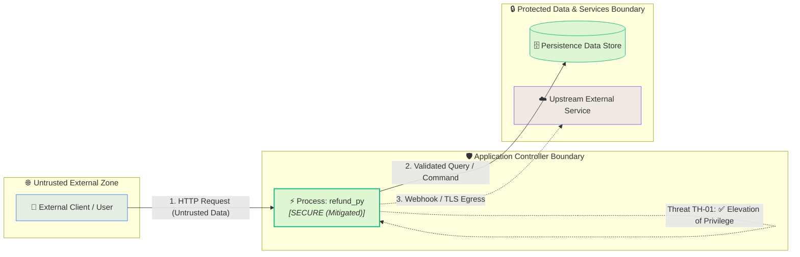

# Threat Model: `refund.py`
**Target Component:** `src/payments/refund.py`  
**Status:** `APPROVED ✅`  
**Trust Boundaries Crossed:** 2  

## 1. Architectural Summary & Trust Boundaries
STRIDE Threat Analysis for `src/payments/refund.py`. Endpoint: `POST /refund`. Identified 1 threat scenarios across 2 trust boundaries. Status: APPROVED (All high/critical threats mitigated).

### Trust Boundaries Crossed:
- 🔀 `External Client ➔ API Controller Boundary`
- 🔀 `API Controller ➔ Database Data Store Boundary`

## 2. Level-1 Data Flow Diagram (DFD)

## 3. STRIDE Threat Matrix
| Threat ID | STRIDE Category | Severity | Impacted Element | Mitigation Status |
| :--- | :--- | :--- | :--- | :--- |
| TH-01 | Elevation of Privilege | HIGH | `transaction_id` | ✅ Mitigated |

## 4. Threat Scenarios & Remediation Guidance
### Threat `TH-01`: Elevation of Privilege on `transaction_id`
- **Severity:** `HIGH`
- **Vulnerability Scenario:** Object identifier 'transaction_id' is properly verified against caller identity.
- **Mitigation Details:** Adequately guarded in current implementation.

<!-- SECURITY TAMPER-PROOF SEAL (Ed25519) -->
**Digital Seal:** `hINPuwlkb5S7+7Kq0LZY6sO0UabpEOOWjGV4viXktWc/+0YQhri0yabEjx//0LjQD+gJazqKvirjW1FISFBTCQ==`
